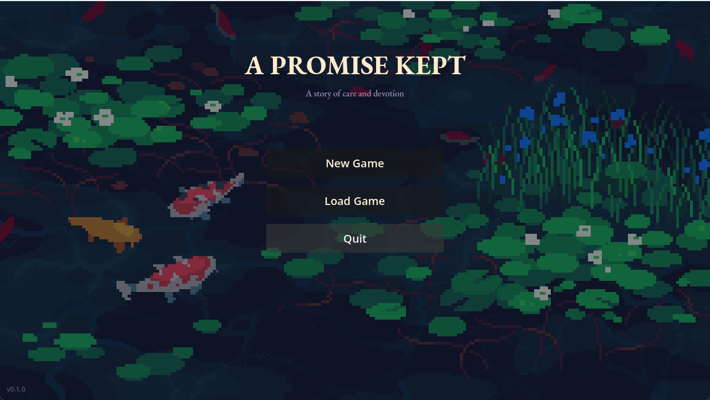
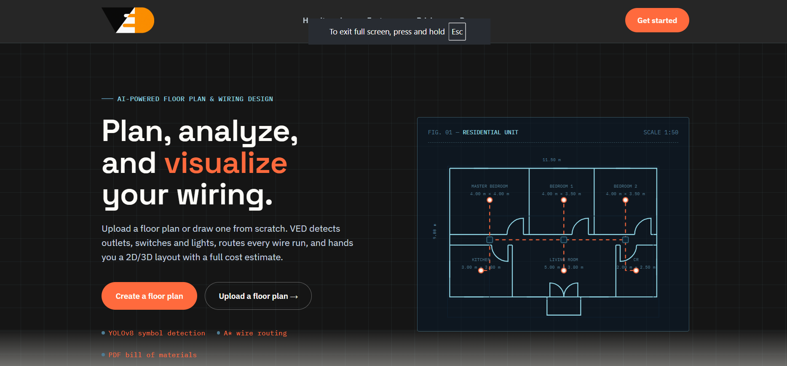

<div align="center">

# Aldrin E. Generoso

**Software Engineer · Computer Science Student**

Turning ideas into experiences.

[LinkedIn](https://www.linkedin.com/in/aldrin-esmeralda-generoso-633b1a416/) · [GitHub](https://github.com/aldringeneroso) · [Email](mailto:aldringeneroso1@gmail.com) · [Résumé](public/assets/aldrin-generoso-resume.pdf)

**React 19 / JavaScript / Vite 8 / Tailwind CSS 4**

</div>

---

## The portfolio

A personal space for my work in software engineering, web applications, and game development. I’m studying Computer Science at Cavite State University’s Bacoor City Campus, based in Bacoor, Cavite, Philippines. My experience includes an MIS internship at B Hotel.

The site pairs a black-and-white editorial layout with full-color photography and project screenshots. Large serif headings, restrained motion, and a persistent light/dark toggle keep the focus on the work.

### Inside the site

- **Introduction & about** — my background, interests, portrait, and quick access to LinkedIn, GitHub, and my résumé.
- **Featured work** — project screenshots, descriptions, technology tags, and source repositories.
- **Toolkit & journey** — skills, education, internship, and certification.
- **Contact** — direct contact links and an EmailJS form with a designed inbox notification.
- **Thoughtful details** — responsive layouts, reduced-motion support, keyboard focus states, a skip link, and self-hosted Font Awesome font icons.

## Featured projects

### 01 / Unnamed Fantasy: A Promise Kept

[](https://github.com/aldringeneroso/Unnamed-Fantasy-A-Promise-Kept)

A visual novel and action-RPG hybrid with branching narrative events. Modular systems manage health, economy, affection, and day progression, with JSON-based multi-slot saves.

**Godot 4 · Dialogic 2 · JSON**

[Explore the repository](https://github.com/aldringeneroso/Unnamed-Fantasy-A-Promise-Kept)

### 02 / AI Floorplan Analysis

[](https://github.com/aldringeneroso/ai-floorplan-analysis)

An AI-assisted floor-plan analysis and electrical planning application for VED Electrical Services. It supports floor-plan uploads, review of detected rooms, walls, and electrical symbols, synchronized 2D/3D layouts, electrical routing, and material-based cost estimates.

**React · FastAPI · MySQL · OpenCV · Three.js**

[Explore the repository](https://github.com/aldringeneroso/ai-floorplan-analysis)

## Portfolio tech stack

| Layer               | Technology                  | Role                                                      |
| ------------------- | --------------------------- | --------------------------------------------------------- |
| Interface           | React 19 + JavaScript       | Reusable portfolio sections and interactive controls      |
| Development & build | Vite 8                      | Local development and static production output            |
| Styling             | Tailwind CSS 4 + custom CSS | Responsive composition, typography, and theme tokens      |
| Motion              | GSAP + ScrollTrigger        | Entrance animations, section reveals, and scroll progress |
| Text layout         | Pretext                     | Balanced headings with visible text fallbacks             |
| Contact             | EmailJS Browser SDK         | Direct email delivery from the contact form               |
| Icons               | Font Awesome Free 7.3.1     | Local WOFF2 solid and brand icons; no SVG rendering       |
| Résumé authoring    | Python + ReportLab          | Reproducible one-page PDF built from portfolio content    |

## Run locally

Use **Node.js 22.12+**, or Node.js 20.19+ within the 20.x release line, and npm.

```sh
npm ci
npm run dev
```

Open the local URL printed by Vite. To create and preview a production build:

```sh
npm run build
npm run preview
```

The build is written to `dist/`. Vercel configuration is included in [vercel.json](vercel.json).

## Make it your own

| Update                                                    | Location                                                           |
| --------------------------------------------------------- | ------------------------------------------------------------------ |
| Biography, skills, projects, education, and contact links | [src/content.js](src/content.js)                                   |
| Page composition and sections                             | [src/components/Portfolio.jsx](src/components/Portfolio.jsx)       |
| Featured project presentation                             | [src/components/Projects.jsx](src/components/Projects.jsx)         |
| Colors, typography, spacing, and responsive layouts       | [src/index.css](src/index.css)                                     |
| Scroll and reveal animations                              | [src/hooks/usePortfolioMotion.js](src/hooks/usePortfolioMotion.js) |
| Photos, screenshots, font icons, and résumé               | [public/assets/](public/assets/)                                   |

Keep static assets in `public/assets/` and reference them with `/assets/` URLs. Photos and project screenshots retain their colors in both themes.

### Contact form

The form uses the configured public EmailJS identifiers. To use another account, copy [.env.example](.env.example) to `.env.local`, set all three values, and restart Vite:

```dotenv
VITE_EMAILJS_SERVICE_ID=your_service_id
VITE_EMAILJS_TEMPLATE_ID=your_template_id
VITE_EMAILJS_PUBLIC_KEY=your_public_key
```

The receiving email and reply settings are configured in the EmailJS template. See the [email setup guide](emails/README.md) for the complete configuration and the [notification template](emails/contact-notification.html). Only public browser identifiers belong in `VITE_` variables; keep passwords, private keys, and OAuth tokens out of the project.

### Downloadable résumé

The [one-page résumé](public/assets/aldrin-generoso-resume.pdf) follows the featured projects and portfolio content. To regenerate it with Python, Node.js, and ReportLab available:

```sh
python scripts/build-resume.py
```

Review the generated PDF before publishing. The site download remains `/assets/aldrin-generoso-resume.pdf`.

## Design credits

- **Project presentation:** adapted from [Brittany Chiang’s v4 portfolio](https://github.com/bchiang7/v4), with separate image and text columns.
- **Résumé layout:** adapted from [Jake Gutierrez’s Resume](https://github.com/jakegut/resume).
- **Contact notification:** adapted from [Lee Munroe’s responsive HTML email template](https://github.com/leemunroe/responsive-html-email-template).
- **Iconography:** [Font Awesome Free](https://github.com/FortAwesome/Font-Awesome/tree/7.3.1/webfonts), self-hosted as webfonts.

See [design references](docs/DESIGN_REFERENCES.md), [layout licenses](docs/licenses/), the [email template license](emails/LICENSE.txt), and the [Font Awesome license](public/assets/icons/LICENSE.txt) for attribution and implementation details.

---

<div align="center">

**Have a project, opportunity, or idea in mind?**

[Let’s connect on LinkedIn](https://www.linkedin.com/in/aldrin-esmeralda-generoso-633b1a416/) · [Send an email](mailto:aldringeneroso1@gmail.com)

</div>
